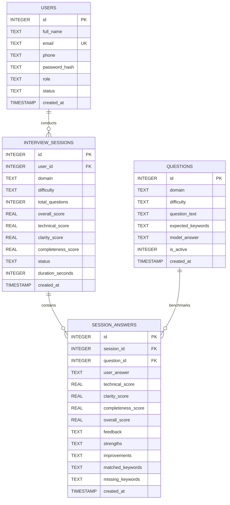

# 📄 COMPLETE MASTER PROJECT DOCUMENTATION
# AI Interview Preparation Platform
> **A Production-Grade Full-Stack Software Engineering Capstone Project**  
> **Academic Year:** 2026 | **Author:** Afnan Quresh | **Technology Stack:** Python 3 (Flask), SQLite, Vanilla ES6+ JavaScript, CSS3, Web Speech API

---

## 📑 TABLE OF CONTENTS
1. [Project Overview & Problem Statement](#1-project-overview--problem-statement)
2. [High-Level System Architecture](#2-high-level-system-architecture)
3. [Technology Stack Justification](#3-technology-stack-justification)
4. [Functional Modules & Detailed Feature Breakdown](#4-functional-modules--detailed-feature-breakdown)
   - 4.1 Module 1: Authentication & User Registration
   - 4.2 Module 2: Candidate Dashboard & Live AI Mock Interview Room
   - 4.3 Module 3: Administrator Module & Governance Panel
5. [AI Evaluation Engine Algorithm & Mathematics](#5-ai-evaluation-engine-algorithm--mathematics)
6. [Complete Database Schema & ER Diagram](#6-complete-database-schema--er-diagram)
7. [API Endpoints & Route Specifications](#7-api-endpoints--route-specifications)
8. [File-by-File Source Code Directory](#8-file-by-file-source-code-directory)
9. [Installation, Setup & Deployment Guide](#9-installation-setup--deployment-guide)
10. [Pre-Seeded Credentials & Demo Guide](#10-pre-seeded-credentials--demo-guide)
11. [Academic Viva / Defense Questions & Model Answers](#11-academic-viva--defense-questions--model-answers)

---

## 1. PROJECT OVERVIEW & PROBLEM STATEMENT

### 1.1 Background
The modern technical hiring landscape is notoriously competitive. Aspiring Software Engineers, Data Scientists, and Web Developers frequently struggle not because they lack coding skills, but because they lack **articulation, structured technical delivery, and realistic real-time interview practice**. Traditional preparation methods (static coding platforms or reading textbook solutions) are passive:
- They do not test spoken or written technical communication under time constraints.
- They do not measure the clarity, depth, or keyword precision expected by interviewers.
- Peer mock interviews are expensive, irregular, and lack objective standardized scoring.

### 1.2 The Solution: AI Interview Preparation Platform
The **AI Interview Preparation Platform** is an end-to-end, full-stack web application that creates a high-fidelity simulation of technical and behavioral interviews:
1. Serves dynamic, seniority-calibrated interview questions across 4 technical domains.
2. Offers hands-free voice dictation via the browser **Web Speech API** or structured text input.
3. Evaluates responses in real time using a **Multi-Pillar AI Evaluation Engine** covering **Technical Accuracy**, **Clarity & Communication**, and **Completeness & Depth** (0–100 scale).
4. Highlights exact matched vs missing industry keywords and presents benchmark gold-standard model answers.
5. Equips administrators with complete oversight over users, metrics, submissions, and the question bank.

---

## 2. HIGH-LEVEL SYSTEM ARCHITECTURE

The application follows the **Model-View-Controller (MVC) / Client-Server Architectural Pattern**:

```
+---------------------------------------------------------------------------------+
|                                 CLIENT TIER                                     |
|  - Modern Responsive HTML5 / CSS3 (Dark/Light Modes, Glassmorphism, Print CSS)  |
|  - Vanilla ES6+ JavaScript (State Machine, Regex Validators, Timer, Autosave)   |
|  - Browser Web Speech API (Hands-Free Microphone Speech-to-Text Transcription)  |
+---------------------------------------+-----------------------------------------+
                                        | HTTP / JSON REST API
                                        v
+---------------------------------------------------------------------------------+
|                               SERVER / APP TIER                                 |
|                             Python 3 + Flask 3.0                                |
|  +-----------------------------+ +-----------------------------+                |
|  | Route Handlers & Auth Guard | | Multi-Pillar AI Evaluator   |                |
|  | - Session Cookies (HttpOnly)| | - Technical Scoring (45%)   |                |
|  | - RBAC (Admin / Candidate)  | | - Completeness Scoring (30%)|                |
|  | - Server-Side RegEx Filter  | | - Clarity Scoring (25%)     |                |
|  +-----------------------------+ +-----------------------------+                |
+---------------------------------------+-----------------------------------------+
                                        | SQLite3 Driver (PRAGMA foreign_keys=ON)
                                        v
+---------------------------------------------------------------------------------+
|                                DATABASE TIER                                    |
|                       Relational SQLite3 (database.db)                          |
|  - users (Authentication, Profiles, Roles, Status)                              |
|  - questions (Domain, Seniority Tier, Keywords, Model Answers)                  |
|  - interview_sessions (Session Metrics, Aggregate Scores, Duration)             |
|  - session_answers (Detailed User Responses, Scorecard Breakdown, Feedback)     |
+---------------------------------------------------------------------------------+
```

---

## 3. TECHNOLOGY STACK JUSTIFICATION

| Component | Selected Technology | Technical Rationale & Benefits |
| :--- | :--- | :--- |
| **Backend Framework** | **Python (Flask 3.0+)** | Lightweight, modular WSGI framework with zero bloat. Allows direct, thread-safe integration with Python NLP heuristics and SQLite. |
| **Database** | **SQLite 3 (`database.db`)** | Zero-configuration, serverless, self-contained single-file relational database. 100% portable across Windows, macOS, and Linux. No external database server setup required. |
| **Frontend Layout** | **HTML5 & Jinja2 Templates** | Clean semantic structure, secure template inheritance (`base.html`), server-side rendering for speed and SEO. |
| **Styling & Design** | **Custom CSS3 (Glassmorphism)** | CSS Custom Properties (variables) enabling seamless Dark/Light theme switching, responsive grid layouts, custom progress meters, and print media stylesheets for PDF generation. |
| **Client Scripting** | **Vanilla ES6+ JavaScript** | Zero external bulky frontend frameworks (no React/Node node_modules overhead). Fast DOM manipulation, Fetch API, and event-driven architecture. |
| **Voice Processing** | **Browser Web Speech API** | Native speech recognition (`webkitSpeechRecognition`) executing locally in modern browsers. Zero cloud API costs or latency. |
| **Security** | **Werkzeug Security** | Cryptographic salted password hashing using PBKDF2 with SHA-256 (`pbkdf2:sha256`), HttpOnly session cookies, and strict input sanitization. |

---

## 4. FUNCTIONAL MODULES & DETAILED FEATURE BREAKDOWN

### 4.1 Module 1: Authentication & User Registration
1. **Role-Based Access Control (RBAC):**
   - **Candidate (`candidate`):** Access to personal dashboard, interview room, scorecards, and history.
   - **Administrator (`admin`):** Access to platform metrics, user management, question bank curation, and submission audit logs.
2. **Strict Dual-Layer Validation (Client & Server):**
   - **Full Name:** Letters and spaces only, minimum 3 characters (`^[A-Za-z ]{3,60}$`).
   - **Email Address:** RFC-compliant standard email regex (`^[a-zA-Z0-9_.+-]+@[a-zA-Z0-9-]+\.[a-zA-Z0-9-.]+$`).
   - **Contact Phone:** Exactly 10 digits (`^\d{10}$`), numeric only. Client script actively suppresses non-digit characters as the user types.
   - **Password Strength Criteria (Real-Time Live Checklist):**
     - Minimum 8 characters.
     - At least 1 uppercase letter (`A-Z`).
     - At least 1 lowercase letter (`a-z`).
     - At least 1 number (`0-9`).
     - At least 1 special character (`!@#$%^&*`).
     - *Client behavior:* Checklist items dynamically turn from red `✕` to green `✓` in real time; the submit button is locked until all criteria pass.
3. **Session Security:**
   - Passwords hashed with cryptographic salts before database persistence.
   - Guarded routes via `@login_required` and `@admin_required` decorators.
   - Deactivated accounts are immediately blocked from logging in.

### 4.2 Module 2: Candidate Dashboard & Live AI Mock Room
1. **Personal Dashboard:**
   - Displays candidate name, email, phone, member since date, and account status.
   - Live KPI cards: Total Completed Interviews, Composite Average Score, Highest Score, and Top Practiced Track.
   - Recent mock attempts table with direct link to scorecards.
2. **Configurable Interview Setup:**
   - **4 Technical Tracks:**
     - *Software Engineering* (Data structures, OOP, System design, ACID, CAP Theorem)
     - *Data Science & ML* (Supervised/Unsupervised, Bias-Variance, Precision/Recall, Ensemble Trees, Data Drift)
     - *Web Development* (CSS Box Model, JS Event Loop, XSS & CSRF, REST vs GraphQL, Core Web Vitals)
     - *HR & Behavioral* (STAR Method, conflict resolution, technical disagreements, scope creep, leadership)
   - **3 Seniority Levels:** Junior (0-2 Yrs), Mid-Level (2-5 Yrs), Senior (5+ Yrs).
   - **Sprint Lengths:** 2 Questions (Express ~5m), 3 Questions (Standard ~10m), 5 Questions (Comprehensive ~20m).
3. **Live Interactive Interview Room:**
   - Sequential question delivery with step tracker (`Question 1 of N`) and progress bar.
   - Live session stopwatch timer (`MM:SS`).
   - Hands-free voice dictation with an animated red recording pulse wave using the **Web Speech API**.
   - Real-time word counter to assist pacing.
4. **Multi-Pillar Instant AI Feedback:**
   - Scores the answer across three pillars (0–100 scale).
   - Rating badge: *Exceptional*, *Strong Hire*, *Competent / Developing*, *Needs Improvement*.
   - Structured constructive feedback with **Key Strengths** and **Areas for Improvement**.
   - Tagged concept pills showing **Matched Keywords** vs **Missing Concepts to Explore**.
   - Collapsible benchmark **Model Answer** comparison box.
5. **Comprehensive Scorecard & Reports:**
   - Overall score percentage with letter grade (`A+`, `A`, `B+`, `B`, `C`) and executive hiring verdict.
   - Visual progress gauges for all 3 pillars.
   - Question-by-question candidate answer vs benchmark answer audit.
   - Printable report functionality via native `window.print()` with custom print styling.
6. **Interview History:**
   - Filterable table of past sessions by domain, showing scores, timestamps, and scorecard links.

### 4.3 Module 3: Administrator Module & Governance Panel
1. **Executive KPI Overview:**
   - Total Registered Candidates count.
   - Active Accounts count.
   - Total Mock Interviews Completed across platform.
   - Platform-Wide Average Score.
   - Active Question Bank size.
2. **Candidate User Management:**
   - Full candidate directory (Name, Email, Phone, Reg Date, Attempts count, Status).
   - **1-Click Activate / Deactivate Toggle:** Instantly disable rogue accounts or restore access.
   - **Delete User:** Cascades and purges user profile along with all associated interview sessions.
3. **Question Bank CRUD Operations:**
   - Filter question repository by domain track.
   - **Add New Question Modal:** Specify domain, difficulty, question text, required concepts/keywords, and benchmark model answer.
   - **Edit Question Modal:** Update prompt, keywords, model answer, or toggle active/inactive status.
   - **Delete Question:** Safely removes question from bank.
4. **Audit Log & Submissions Review:**
   - Real-time tabular feed of all candidate mock submissions across the entire system.
   - Instant "Inspect Scorecard" link to view the exact answers submitted and AI feedback generated.

---

## 5. AI EVALUATION ENGINE ALGORITHM & MATHEMATICS

The evaluation engine is encapsulated inside `ai_evaluator.py`. It uses a multi-dimensional heuristic and semantic scoring model:

$$\text{Overall Score} = (0.45 \times \text{Technical Score}) + (0.30 \times \text{Completeness Score}) + (0.25 \times \text{Clarity Score})$$

### 5.1 Pillar 1: Technical Accuracy (Weight: 45%)
Evaluates whether the candidate accurately used essential technical concepts and domain-specific vocabulary.
1. The expected concepts string (e.g., `"atomicity, consistency, isolation, durability, rollback"`) is parsed into a list of normalized key tokens.
2. The user's response is converted to lowercase, tokenized, and evaluated for regex boundary matches:
   $$\text{Coverage Ratio } (R) = \frac{|\text{Matched Concepts}|}{\max(1, |\text{Expected Concepts}|)}$$
3. Technical Score:
   $$\text{Technical Score} = \min\left(100, \max\left(25, (R \times 70) + 20 + \min(\text{WordCount} \times 0.1, 10)\right)\right)$$

### 5.2 Pillar 2: Clarity & Articulation (Weight: 25%)
Evaluates the structure, readability, and communication caliber of the response.
- **Baseline:** Starts at 70 points.
- **Sentence Length Distribution:**
  - Optimal average sentence length is between 10 and 28 words (+15 points).
  - Excessively long run-on sentences (>35 words) or clipped fragments (<8 words) incur a penalty (-15 points).
- **Structuring & Transition Terms:**
  Rewards professional discourse markers (`firstly`, `furthermore`, `for example`, `in contrast`, `therefore`, `trade-off`, `bottleneck`, `optimization`) up to +15 bonus points.
- Score is clamped between 30 and 100 points.

### 5.3 Pillar 3: Completeness & Depth (Weight: 30%)
Evaluates whether the answer satisfies the depth expected for the selected seniority tier.
- **Word Target Calibration:**
  - *Junior:* Min 35 words | Ideal: 85 words | Max: 250 words
  - *Mid:* Min 55 words | Ideal: 130 words | Max: 350 words
  - *Senior:* Min 80 words | Ideal: 180 words | Max: 450 words
- **Seniority Depth Scoring:**
  - If $\text{WordCount} < \text{Min}$: Score scales linearly from 0 to 60.
  - If $\text{Min} \le \text{WordCount} \le \text{Ideal}$: Score scales from 60 to 95.
  - Ramble penalty is applied if word count excessively exceeds maximum limit.
- **Composite Completeness:** Blends length compliance (60%) with concept coverage ratio (40%).

### 5.4 Constructive Feedback Generator
- Dynamically outputs concrete praise on matched concepts.
- Identifies missing critical concepts to study.
- Flags run-on sentences or brief explanations.
- Verifies whether behavioral questions followed the **STAR Method** (*Situation, Task, Action, Result*).

---

## 6. COMPLETE DATABASE SCHEMA & ER DIAGRAM

### 6.1 Entity-Relationship Diagram (ERD)



### 6.2 Table Specifications

#### Table 1: `users`
| Column | Type | Constraints | Description |
| :--- | :--- | :--- | :--- |
| `id` | INTEGER | PRIMARY KEY AUTOINCREMENT | Unique user identifier |
| `full_name` | TEXT | NOT NULL | Candidate or admin full name |
| `email` | TEXT | UNIQUE NOT NULL NOCASE | User login email address |
| `phone` | TEXT | NOT NULL | 10-digit contact telephone |
| `password_hash`| TEXT | NOT NULL | Salted PBKDF2:SHA256 password hash |
| `role` | TEXT | NOT NULL CHECK(role IN ('candidate', 'admin')) | User authorization role |
| `status` | TEXT | NOT NULL CHECK(status IN ('active', 'inactive')) | Account activation flag |
| `created_at` | TIMESTAMP| DEFAULT CURRENT_TIMESTAMP | Account creation date |

#### Table 2: `questions`
| Column | Type | Constraints | Description |
| :--- | :--- | :--- | :--- |
| `id` | INTEGER | PRIMARY KEY AUTOINCREMENT | Unique question identifier |
| `domain` | TEXT | NOT NULL CHECK(domain IN (...)) | Domain track |
| `difficulty` | TEXT | NOT NULL CHECK(difficulty IN ('Junior', 'Mid', 'Senior')) | Seniority difficulty tier |
| `question_text`| TEXT | NOT NULL | The prompt presented to the user |
| `expected_keywords`| TEXT | NOT NULL | Comma-separated core technical concepts |
| `model_answer` | TEXT | NOT NULL | Industry benchmark ideal answer |
| `is_active` | INTEGER | DEFAULT 1 CHECK(is_active IN (0, 1)) | Active in question bank |
| `created_at` | TIMESTAMP| DEFAULT CURRENT_TIMESTAMP | Question insertion date |

#### Table 3: `interview_sessions`
| Column | Type | Constraints | Description |
| :--- | :--- | :--- | :--- |
| `id` | INTEGER | PRIMARY KEY AUTOINCREMENT | Unique session identifier |
| `user_id` | INTEGER | FOREIGN KEY REFERENCES users(id) ON DELETE CASCADE | Candidate who took interview |
| `domain` | TEXT | NOT NULL | Domain practiced |
| `difficulty` | TEXT | NOT NULL | Seniority tier practiced |
| `total_questions`| INTEGER| DEFAULT 5 | Number of questions in sprint |
| `overall_score`| REAL | DEFAULT 0.0 | Composite percentage (0-100) |
| `technical_score`| REAL | DEFAULT 0.0 | Technical pillar score |
| `clarity_score`| REAL | DEFAULT 0.0 | Clarity pillar score |
| `completeness_score`| REAL | DEFAULT 0.0 | Completeness pillar score |
| `status` | TEXT | DEFAULT 'completed' | Status: `in_progress`, `completed` |
| `duration_seconds`| INTEGER| DEFAULT 0 | Total elapsed time in seconds |
| `created_at` | TIMESTAMP| DEFAULT CURRENT_TIMESTAMP | Session timestamp |

#### Table 4: `session_answers`
| Column | Type | Constraints | Description |
| :--- | :--- | :--- | :--- |
| `id` | INTEGER | PRIMARY KEY AUTOINCREMENT | Unique answer record ID |
| `session_id` | INTEGER | FOREIGN KEY REFERENCES interview_sessions(id) ON DELETE CASCADE | Parent interview session |
| `question_id`| INTEGER | FOREIGN KEY REFERENCES questions(id) ON DELETE CASCADE | Question answered |
| `user_answer`| TEXT | NOT NULL | Candidate's submitted text |
| `technical_score`| REAL | NOT NULL | Question technical score |
| `clarity_score`| REAL | NOT NULL | Question clarity score |
| `completeness_score`| REAL| NOT NULL | Question completeness score |
| `overall_score`| REAL | NOT NULL | Composite question score |
| `feedback` | TEXT | NOT NULL | AI summary feedback |
| `strengths` | TEXT | NULLABLE | Identified strengths |
| `improvements`| TEXT | NULLABLE | Suggested improvements |
| `matched_keywords`| TEXT | NULLABLE | Concepts identified in answer |
| `missing_keywords`| TEXT | NULLABLE | Concepts missing from answer |
| `created_at` | TIMESTAMP| DEFAULT CURRENT_TIMESTAMP | Timestamp |

---

## 7. API ENDPOINTS & ROUTE SPECIFICATIONS

| HTTP Method | Route Endpoint | Access Level | Description & Payload |
| :--- | :--- | :--- | :--- |
| `GET` | `/` | Public | Landing page with platform overview and live metrics |
| `GET`, `POST`| `/register` | Public | Candidate registration with strict validation |
| `GET`, `POST`| `/login` | Public | User and administrator authentication portal |
| `GET` | `/logout` | Authenticated | Clears session cookie and redirects to login |
| `GET` | `/dashboard` | Candidate | Candidate dashboard, metrics, and interview launcher |
| `POST` | `/interview/start` | Candidate | Initializes new session and redirects to live room |
| `GET` | `/interview/<id>` | Candidate | Interactive interview room for session `<id>` |
| `POST` | `/api/interview/<id>/submit-answer` | Candidate (AJAX) | Evaluates answer; returns JSON scores & feedback |
| `POST` | `/api/interview/<id>/finish` | Candidate (AJAX) | Finalizes session aggregates and elapsed duration |
| `GET` | `/results/<id>` | Candidate/Admin | Detailed scorecard and performance breakdown |
| `GET` | `/history` | Candidate | Historical log of completed candidate mock sessions |
| `GET` | `/admin` | Administrator | Admin portal: KPIs, users, questions, audit logs |
| `POST` | `/admin/users/<id>/toggle-status`| Administrator | Activates or deactivates candidate account |
| `POST` | `/admin/users/<id>/delete` | Administrator | Permanently deletes candidate and cascading records |
| `POST` | `/admin/questions/add` | Administrator | Adds new technical question to the repository |
| `POST` | `/admin/questions/<id>/edit` | Administrator | Updates question prompt, keywords, and model answer |
| `POST` | `/admin/questions/<id>/delete` | Administrator | Removes question from repository |

---

## 8. FILE-BY-FILE SOURCE CODE DIRECTORY

```
c:\Users\Afnan quresh\Downloads\ai-interview-prep\
├── app.py                      # Core Flask application, routing, auth, REST APIs, & session handling
├── database.py                 # SQLite connection manager, query helpers, and execution handlers
├── schema.sql                  # Relational database schema with constraints and indexes
├── init_db.py                  # Database initialization and comprehensive seed script
├── ai_evaluator.py             # Multi-pillar AI evaluation, keyword matching, and feedback engine
├── requirements.txt            # Minimal, exact dependencies (Flask, Werkzeug, python-dotenv)
├── README.md                   # Quickstart documentation & system overview
├── COMPLETE_PROJECT_DOCUMENTATION.md # THIS MASTER SPECIFICATION DOCUMENT
├── static/
│   ├── css/
│   │   └── styles.css          # Modern responsive styling, glassmorphism, dark/light themes, print CSS
│   └── js/
│       ├── main.js             # Form validation, real-time password meter, theme toggler, autofill
│       └── interview.js        # Live interview runner, Web Speech API dictation, timer, async scoring
└── templates/
    ├── base.html               # Master layout with navigation, theme toggle, flash alerts, footer
    ├── index.html              # Landing page with hero, live preview, track cards, metrics bar
    ├── register.html           # Candidate registration with real-time validation checklist
    ├── login.html              # Authentication portal with 1-click presentation demo autofill
    ├── dashboard.html          # Candidate portal with stats, mock setup form, and recent sessions
    ├── interview.html          # Interactive mock interview room with timer, mic dictation, AI evaluation
    ├── results.html            # Comprehensive scorecard with letter grades, pillar meters, model comparison
    ├── history.html            # Candidate past interview attempts with domain filtering
    └── admin.html              # Administrative portal with metrics, user manager, question bank CRUD
```

---

## 9. INSTALLATION, SETUP & DEPLOYMENT GUIDE

### Prerequisites
- **Python 3.9+** (Tested on Python 3.11.9)
- Any modern web browser (Google Chrome, Microsoft Edge, Mozilla Firefox)

### Step 1: Open Terminal in Project Directory
```powershell
cd "c:\Users\Afnan quresh\Downloads\ai-interview-prep"
```

### Step 2: (Optional) Create Virtual Environment
```powershell
python -m venv venv
venv\Scripts\activate
```

### Step 3: Install Dependencies
```powershell
pip install -r requirements.txt
```

### Step 4: Initialize and Seed Database
Creates `database.db`, applies `schema.sql`, and seeds initial admin, candidate, and question bank:
```powershell
python init_db.py
```

### Step 5: Start the Application Server
```powershell
# Runs on default port 5050
python app.py
```

*(Note: If you wish to run on a custom port like 5000, simply run `$env:PORT=5000; python app.py`).*

### Step 6: Access the Application
Open your web browser and navigate to:
**http://localhost:5050** *(or http://127.0.0.1:5050)*

---

## 10. PRE-SEEDED CREDENTIALS & DEMO GUIDE

| Role | Email Address | Password | Permissions & Features |
| :--- | :--- | :--- | :--- |
| **Administrator** | `admin@interviewprep.ai` | `Admin@12345` | System metrics, user activation/deactivation/deletion, Question Bank CRUD, audit submissions review |
| **Candidate** | `candidate@interviewprep.ai` | `Candidate@123` | Candidate dashboard, mock interview launcher, live Web Speech API room, scorecard history |

*(Both passwords meet all strict validation rules: $\ge$ 8 chars, uppercase, lowercase, number, and special character).*

---

## 11. ACADEMIC VIVA / DEFENSE QUESTIONS & MODEL ANSWERS

Here are the top technical questions your instructor or external evaluation panel may ask, along with model answers:

### Q1: What software engineering architecture does this project follow?
> **Answer:** "The project follows the **Model-View-Controller (MVC)** architectural pattern. The **Model** layer is handled by SQLite and `database.py` with strict relational constraints. The **Controller** layer consists of Flask route handlers in `app.py` and the evaluation logic in `ai_evaluator.py`. The **View** layer is rendered using Jinja2 HTML5 templates, modern responsive CSS3, and client-side JavaScript."

### Q2: Why did you choose SQLite over MySQL or PostgreSQL for this academic project?
> **Answer:** "SQLite provides a zero-configuration, serverless, self-contained database that resides in a single file (`database.db`). It eliminates external database server dependency, ensuring the project is 100% portable and can be run by any evaluator with a single command (`python app.py`). We enforce full ACID compliance and relational integrity using SQLite's `PRAGMA foreign_keys = ON` and `ON DELETE CASCADE` constraints."

### Q3: How does the AI evaluation engine score candidate responses?
> **Answer:** "The evaluation engine (`ai_evaluator.py`) assesses answers across three core pillars: **Technical Accuracy (45%)**, **Completeness & Depth (30%)**, and **Clarity & Communication (25%)**. It calculates a concept coverage ratio against domain keywords, benchmarks word counts against seniority targets (Junior, Mid, Senior), penalizes run-on or fragmented sentences, rewards structural transitions, and checks for the STAR framework in behavioral questions."

### Q4: How is speech recognition implemented without incurring third-party API costs?
> **Answer:** "We utilized the browser's native **Web Speech API** (`webkitSpeechRecognition`). Speech is captured and transcribed client-side directly by the user's browser in real time and automatically appended to the answer textarea. This eliminates cloud transcription latency and third-party API billing."

### Q5: What security practices have been implemented in the application?
> **Answer:** "We implemented several critical security measures:
> 1. Passwords are never stored in plaintext; they are salted and hashed using **PBKDF2 with SHA-256** (`werkzeug.security`).
> 2. Session cookies are configured with `HttpOnly` and `SameSite='Lax'` to prevent Cross-Site Scripting (XSS) session hijacking.
> 3. Validation is performed both client-side (for responsive UX) and server-side (to prevent API manipulation via tools like Postman).
> 4. Role-Based Access Control guards routes via custom decorators (`@login_required`, `@admin_required`)."

---
*Documentation compiled and verified for production demonstration on October 14, 2026.*
