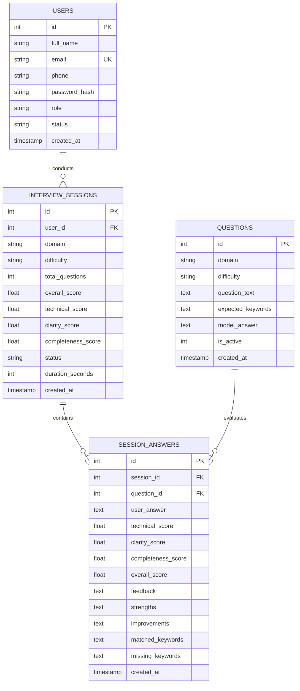

# 🤖 AI Interview Preparation Platform
> **A Production-Ready Full-Stack Academic Engineering Capstone Project**  
> *Engineered with Python (Flask), SQLite, Vanilla ES6+ JavaScript, and Modern Responsive CSS3.*

---

## 📌 Executive Summary

The **AI Interview Preparation Platform** is an intelligent web application designed to prepare aspiring Software Engineers, Data Scientists, and Web Developers for rigorous technical and behavioral recruitment interviews.

The platform combines **real-time AI heuristic and semantic evaluation**, **voice speech-to-text dictation via the browser Web Speech API**, dynamic seniority-calibrated question banking, and administrative governance to deliver a complete hiring simulation.

---

## 🚀 Key Modules & Architecture

### 🛡️ Module 1: Authentication & User Registration
- **Role-Based Access Control (RBAC):** Distinct roles for **Candidates** and **Administrators** (`admin`).
- **Strict Server-Side & Client-Side Form Validations:**
  - **Full Name:** Letters and spaces only, minimum 3 characters (`^[A-Za-z ]{3,}$`).
  - **Email Address:** RFC-compliant email regex format.
  - **Contact Number:** Exactly 10 digits (`^\d{10}$`), numeric only.
  - **Password Strength Criteria:** Minimum 8 characters, at least 1 uppercase letter (`A-Z`), 1 lowercase letter (`a-z`), 1 number (`0-9`), and 1 special symbol (`!@#$%^&*`).
  - **Interactive Real-Time Checklist:** Dynamic UI checklist turns green as requirements are satisfied.
  - **Secure Cryptographic Hashing:** Uses `werkzeug.security` (`pbkdf2:sha256`) for password hashing.
  - **Session Guarding:** Unauthorized users are blocked from protected candidate and admin routes with flash messaging.

### 🎯 Module 2: Candidate Dashboard & Live AI Mock Room
- **Candidate Dashboard:** Overview of candidate profile, total interviews completed, average composite score, highest score, and top practiced domain track.
- **Customizable Interview Launcher:**
  - **4 Domain Tracks:** *Software Engineering*, *Data Science & ML*, *Web Development*, *HR & Behavioral*.
  - **3 Seniority Tiers:** *Junior (0-2 Yrs)*, *Mid-Level (2-5 Yrs)*, *Senior (5+ Yrs)*.
  - **Sprint Lengths:** 2 questions (Express), 3 questions (Standard), or 5 questions (Comprehensive).
- **Interactive Live Interview Room:**
  - Dynamic sequential question delivery with visual step tracker and progress bar.
  - Live session stopwatch timer (`MM:SS`).
  - **Hands-Free Speech-to-Text:** Integrated browser **Web Speech API** dictation with live transcription and visual recording pulse.
  - Live word count tracker.
- **Multi-Pillar AI Evaluation Engine:**
  - **1. Technical Accuracy (0–100):** Scans for required domain concepts, terminology precision, and core algorithmic definitions.
  - **2. Clarity & Communication (0–100):** Evaluates sentence length distribution, logical transitions, structuring keywords, and readability.
  - **3. Completeness & Depth (0–100):** Benchmarks response length against seniority expectations (Junior: ~50-80w, Mid: ~80-140w, Senior: ~120-200w+), edge case coverage, and STAR framework adherence.
  - **Overall Composite Score:** Weighted composite score calculation.
  - **Constructive Guidance:** Pinpoints exact strengths, missing keywords to explore, and actionable tips.
  - **Benchmark Model Answers:** Displays the gold standard answer for comparative learning.
- **Detailed Scorecard & History:** Complete review showing performance gauges, question-by-question breakdown, and printable PDF reports (`window.print()`).

### 🛠️ Module 3: Administrator Module & Governance Panel
- **High-Level KPIs:** Total registered candidates, active users, total mock interviews conducted, platform average score, active question bank size.
- **Candidate User Management:** View candidate directory (Name, Email, Phone, Reg Date, Attempts), 1-click **Activate / Deactivate** account status, and permanent account deletion.
- **Question Bank CRUD:** Filter questions by domain, add new questions with required key concepts and model answers, edit existing questions, or delete obsolete ones.
- **Audit Log & Submissions:** System-wide log of candidate interview sessions, domain scores, and direct inspection of candidate answers vs AI grading.

---

## 🗄️ Database Schema Design (`database.db`)

The platform utilizes a zero-configuration, relational SQLite database with strict foreign keys and automated initialization:



---

## 🔑 Demo & Presentation Credentials

Pre-seeded accounts are immediately available upon running `python init_db.py` (and on the login page via **1-Click AutoFill buttons**):

| Role | Email | Password | Permissions |
| :--- | :--- | :--- | :--- |
| **Administrator** | `admin@interviewprep.ai` | `Admin@12345` | Full system metrics, user activation/deactivation, question bank CRUD, audit log |
| **Candidate** | `candidate@interviewprep.ai` | `Candidate@123` | Dashboard, live mock interview setup, AI scorecards, attempts history |

*(Both passwords meet all strict validation criteria: $\ge$ 8 chars, uppercase, lowercase, digit, and special character).*

---

## 💻 Installation & Quickstart Guide

### 1. Prerequisites
- **Python 3.9+** (Tested on Python 3.11)
- Modern web browser (Google Chrome, Microsoft Edge, Firefox, or Safari)

### 2. Clone / Navigate to Project Directory
```bash
cd "c:\Users\Afnan quresh\Downloads\ai-interview-prep"
```

### 3. (Optional) Create Virtual Environment
```bash
python -m venv venv

# Windows:
venv\Scripts\activate

# macOS / Linux:
source venv/bin/activate
```

### 4. Install Dependencies
```bash
pip install -r requirements.txt
```

### 5. Initialize & Seed Database
This creates the schema and populates the question bank with over 20+ verified technical and behavioral questions:
```bash
python init_db.py
```

### 6. Start the Flask Application
```bash
python app.py
```

### 7. Access in Browser
Open your browser and navigate to:
```
http://127.0.0.1:5000
```

---

## 📂 Project Directory Structure

```
ai-interview-prep/
├── app.py                      # Core Flask application, routing, auth, REST APIs, & session handling
├── database.py                 # SQLite connection manager, query helpers, and execution handlers
├── schema.sql                  # Relational database schema with constraints and indexes
├── init_db.py                  # Database initialization and comprehensive seed script
├── ai_evaluator.py             # Multi-pillar AI evaluation, keyword matching, and feedback engine
├── requirements.txt            # Dependency manifest (Flask, Werkzeug, python-dotenv)
├── README.md                   # Complete architectural documentation & installation guide
├── static/
│   ├── css/
│   │   └── styles.css          # Modern responsive styling, glassmorphism, dark/light themes
│   └── js/
│       ├── main.js             # Form validation, real-time password meter, theme toggler, autofill
│       └── interview.js        # Live interview runner, Web Speech API dictation, timer, async scoring
└── templates/
    ├── base.html               # Master layout with navigation, theme toggle, flash alerts, footer
    ├── index.html              # Landing page with hero, live preview, track cards, metrics bar
    ├── register.html           # Candidate registration with real-time validation checklist
    ├── login.html              # Authentication portal with 1-click presentation demo autofill
    ├── dashboard.html          # Candidate portal with stats, mock setup form, and recent sessions
    ├── interview.html          # Interactive mock interview room with timer, mic dictation, AI evaluation
    ├── results.html            # Comprehensive scorecard with letter grades, pillar meters, model comparison
    ├── history.html            # Candidate past interview attempts with domain filtering
    └── admin.html              # Administrative portal with metrics, user manager, question bank CRUD
```

---

## 🧠 AI Evaluation Engine Logic (`ai_evaluator.py`)

The evaluation engine assesses candidate responses across three pillars:

$$\text{Overall Score} = (0.45 \times \text{Technical Score}) + (0.30 \times \text{Completeness Score}) + (0.25 \times \text{Clarity Score})$$

1. **Technical Accuracy:**
   $$\text{Coverage Ratio} = \frac{|\text{Matched Core Concepts}|}{|\text{Expected Concepts}|}$$
   Matches normalized word stems against essential terminology (e.g., `ACID`, `CAP Theorem`, `Event Loop`, `O(1)`).
2. **Clarity & Communication:**
   Analyzes sentence variety, penalizes run-on sentences ($>35$ words) or fragments ($<8$ words), and rewards transitional logic words (`firstly`, `in contrast`, `therefore`, `trade-off`).
3. **Completeness & Depth:**
   Compares length and substance against target seniority ranges ($J=85\text{w}, M=130\text{w}, S=180\text{w}$). Detects STAR framework components (`Situation`, `Task`, `Action`, `Result`) for behavioral questions.

---

## 🎓 Academic Viva & Presentation Talking Points

When presenting this project to your instructor or evaluation panel:
1. **Zero-Configuration Portability:** Emphasize that SQLite requires no external database server to be installed; `python init_db.py` sets up everything in seconds.
2. **Security & Validation Rigor:** Point out that validation is performed **both** client-side (for responsive UX) **and** server-side in Python (to prevent API bypass).
3. **Browser Native Capabilities:** Highlight the integration of the browser's native **Web Speech API** (`webkitSpeechRecognition`) for simulated spoken interviews without third-party cloud costs.
4. **Relational Integrity:** Explain the foreign key cascading rules (`ON DELETE CASCADE`), ensuring database hygiene when users or sessions are deleted.
5. **Modern Frontend Aesthetics:** Note the custom CSS architecture featuring dark/light mode toggle with `localStorage` memory and full print stylesheet optimization for scorecard generation.
